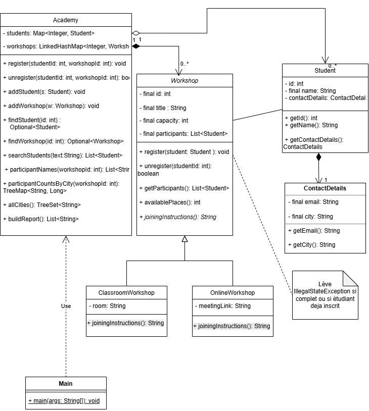

# Academy Workshops

A small Java application that manages student registrations for an academy's workshops, and produces a readable participant report.

Built during my Java backend training at HackYourFuture Brussels, as a review of object-oriented programming, collections, streams and unit testing.

## Features

- Two kinds of workshops: **classroom** (with a room) and **online** (with a meeting link)
- Register and unregister students, with business rules:
    - a student can join several workshops, but only once each
    - a full workshop rejects new registrations
    - unregistering frees a place, and the student stays in the academy
- Search students by name (case-insensitive)
- Reports: sorted participant names, participant count by city, all cities
- A text report listing each workshop with its participants

## Example output

```
Java Basics | 2/2 participants
Go to room B12
- Chitrakalpa
- Gayatri

JUnit Practice | 2/3 participants
Join the course via: https://example.com/junit
- Chitrakalpa
- Oleh
```

## Class diagram



## Design choices

- **Inheritance and polymorphism:** `Workshop` is abstract. `ClassroomWorkshop` and `OnlineWorkshop` each implement `joiningInstructions()`, and the report calls it through the `Workshop` type.
- **Composition:** a `Student` owns an immutable `ContactDetails` object (email and city).
- **Immutability:** students and their contact details cannot change after creation (`final` fields, no setters).
- **Encapsulation:** collections are private, and `getParticipants()` returns an unmodifiable copy, so participants can only be added through `register()`.
- **Collections chosen for their purpose:**
    - `HashMap<Integer, Student>`: find a student by ID
    - `LinkedHashMap<Integer, Workshop>`: find a workshop by ID and keep creation order
    - `ArrayList<Student>` for participants: keep registration order, removal with an explicit `Iterator`
    - `TreeSet<String>` in `allCities()`: each city once, in alphabetical order
    - `TreeMap<String, Long>` in `participantCountsByCity()`: number of participants per city, cities in alphabetical order
- **Responsibilities:** `Academy` finds students and workshops by ID and delegates; each `Workshop` enforces its own registration rules: it rejects new students when full, and rejects a student who is already registered.
- **Validation:** a small `FieldValidator` utility rejects null, blank or non-positive values with clear exceptions.

## Tech

Java 17+ · JUnit 5 · Streams API

## How to run

1. Open the project in IntelliJ IDEA (JDK 17 or later).
2. Run `src/projects/academyApp/Main.java` to see the demo scenario and the report.

## How to run the tests

Right-click the `test` folder → **Run 'All Tests'** (JUnit 5).

The tests cover validation, registration rules, removal, polymorphism, searching, ordered collections and reports, including edge cases (full workshop, duplicate registration, unknown IDs, empty academy).